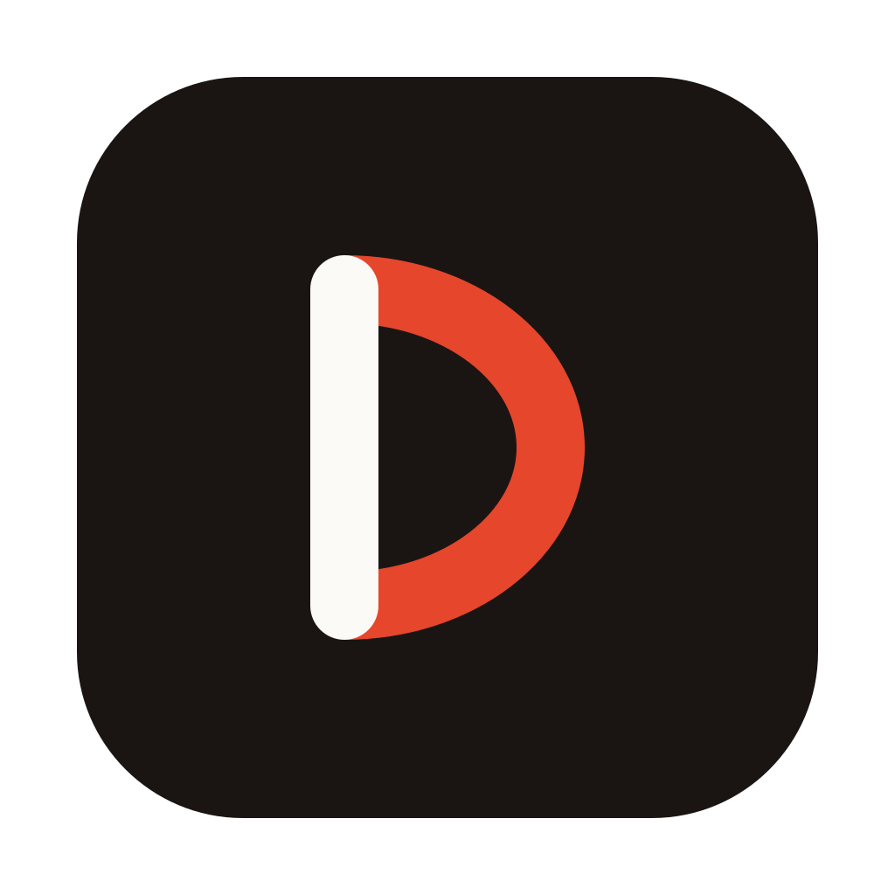
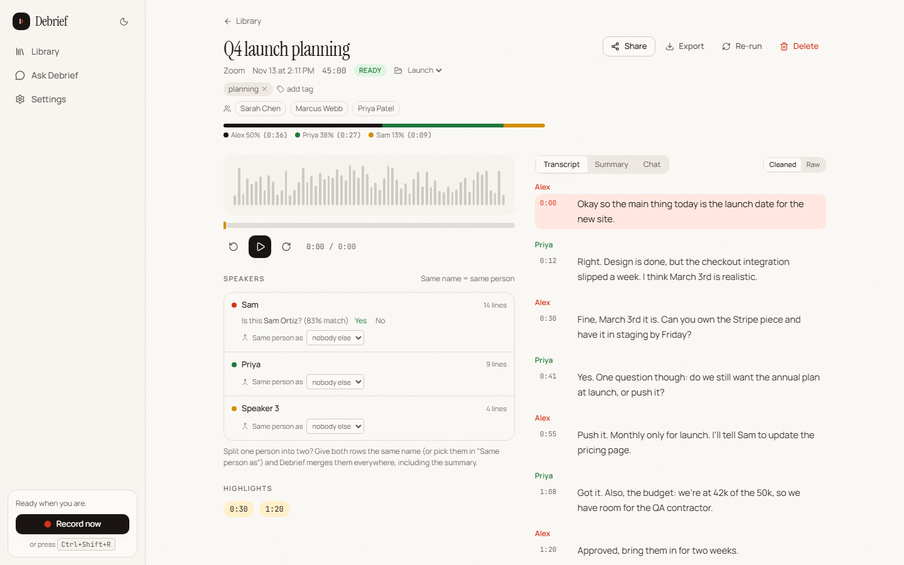
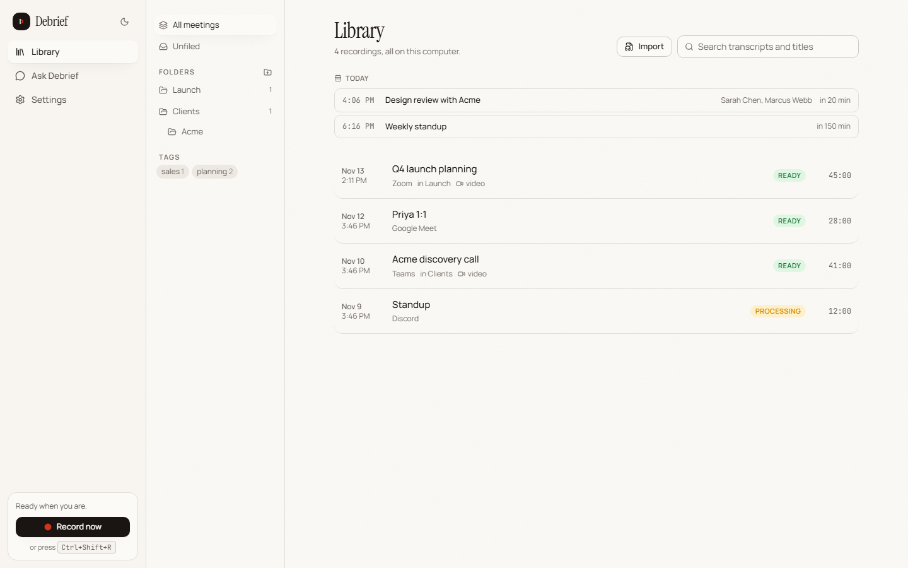

# Debrief: free, open-source AI meeting recorder and transcriber

**Record Zoom, Microsoft Teams and Google Meet calls on your own computer. Get live captions, a speaker-labelled transcript, AI meeting notes and answers to your questions, all offline. A private, local-first alternative to Otter.ai, Fathom and Fireflies.**

[](LICENSE)
[](https://github.com/Dallenlol/debrief/releases)


[](https://github.com/Dallenlol/debrief/stargazers)

Debrief is a desktop app for Windows and macOS. It notices when you're in a call and offers a **Record** button. It never records on its own, and no bot joins your meeting. It captures your mic plus the meeting app's audio (and the screen if you want), transcribes with [Whisper](https://github.com/ggerganov/whisper.cpp), works out who said what, and writes the summary with a local language model ([llama.cpp](https://github.com/ggerganov/llama.cpp)) or your own Claude, OpenAI or OpenRouter key. No account, no subscription, no upload.



## Why Debrief

| | Debrief | Otter.ai | Fathom | Fireflies.ai |
|---|---|---|---|---|
| Price | Free, MIT licensed | Freemium, paid tiers | Freemium, paid tiers | Freemium, paid tiers |
| Where recordings live | Your computer | Their cloud | Their cloud | Their cloud |
| Works offline | Yes | No | No | No |
| Open source | Yes | No | No | No |
| Bring your own AI | Local model, or Claude/OpenAI/OpenRouter key | No | No | No |

## Features

**Recording**
- **Call detection** for Zoom, Teams, Google Meet, Webex, Discord, Slack huddles, FaceTime, GoToMeeting, Whereby, Jitsi, Around, Skype, RingCentral and WhatsApp/Telegram/Signal calls, native or in a browser tab, plus an audio-activity fallback for anything else. It only ever shows a small **Record?** popup.
- **Records only the meeting.** Pick the meeting window or a display. On Windows Debrief captures only that app's audio plus your mic, so music and notifications stay out.
- **Optional screen recording** using the GPU's hardware video encoder (NVIDIA NVENC, AMD AMF, Intel Quick Sync) when there is one.
- **Hard to lose a recording.** Audio is written to disk as it's captured. If a headset disconnects, Debrief switches devices and keeps going; if the app crashes, the recording is finished the next time it starts.

**Transcription**
- **Live captions** while the call runs, finalised within about two seconds of each sentence, plus running notes (topics, decisions, action items) that update every minute or two.
- **Accurate transcript after the call** with Whisper (up to large-v3-turbo on a GPU), in English or 30 other languages.
- **Speaker diarization** (who spoke when) that remembers voices. Name someone once and Debrief suggests them next time. Names can also come from the meeting window, your calendar or the name labels on video tiles.
- **Imports** existing audio and video files: phone voice memos, old Zoom recordings.

**AI meeting notes and search**
- **Summaries** from editable templates: general, sales call, client discovery, 1:1, standup, interview. Meetings title themselves.
- **Ask Debrief:** ask about one meeting or your whole library and get answers with clickable timestamps (hybrid keyword + semantic search).
- **Transcript clean-up** for bad mics and filler words. The raw transcript is always kept.
- **Follow-up email drafts** with decisions and owned action items.

**Sharing and export**
- Export transcripts as **.txt, .srt subtitles or Markdown**, and audio as **MP3**.
- Share with links on your local network, `.debrief` bundles, or a standalone web page.
- An opt-in **webhook** sends finished meetings to Zapier, n8n, Make or your own script.
- Folders, tags, highlights, clips and talk-time stats.



## Lightweight by design

Debrief is a native Rust app built with [Tauri](https://tauri.app), not Electron.

- **Idle** it's a tray icon and a 2-second window check. AI models load only when needed and are unloaded 3 minutes after the last job.
- **While you record** the screen is encoded on the GPU's media engine when available, and live captions reuse one warm Whisper decoder instead of setting it up every few seconds.
- **After the call** transcription, speaker detection and AI run at below-normal CPU priority, so games, calls and your browser stay smooth while it works.
- **Sized for your hardware.** It picks model sizes for your machine, and on CPU-only computers it measures each speech model's real speed and uses the best one that finishes within the recording's own length.

## Install

Download an installer from [Releases](https://github.com/Dallenlol/debrief/releases):

- **Windows, NVIDIA GPU:** the CUDA build (several times faster).
- **Windows, any PC:** the CPU build.
- **macOS:** Apple Silicon or Intel.

More detail in [docs/install.md](docs/install.md) and [Models and hardware](docs/models.md).

## Privacy

- **Local only.** Recordings, transcripts, summaries and chat history stay in one folder on your computer. The only network traffic is downloading AI models from Hugging Face (checked against known checksums), and the cloud AI provider if you choose to add a key.
- **Manual by design.** Detection only shows a popup. Recording, naming speakers and sharing always need a click.

See [docs/privacy.md](docs/privacy.md).

## FAQ

**Is Debrief really free?** Yes. MIT licensed, no tiers, no upsell.

**Does it work without internet?** Yes, completely, once the models are downloaded.

**Does it work with Zoom, Teams and Google Meet?** Yes, and with any other app, because it records the app's audio rather than joining as a bot.

**Can it record in-person meetings?** Yes. Start a recording manually; speaker identification works from the mic alone.

**Is it an Otter.ai alternative?** Yes: live transcription, AI summaries and search, without sending audio to anyone's server.

**Does it slow my computer down?** Barely while idle. Processing after a call runs at low priority, and a GPU build does most of the work on the graphics card.

More in [docs/faq.md](docs/faq.md).

## Building from source

Requirements: [Rust](https://rustup.rs) (stable), [Node 22+](https://nodejs.org) with [pnpm](https://pnpm.io), CMake, a C++ toolchain (MSVC Build Tools on Windows, Xcode CLT on macOS), and libclang (LLVM) for the whisper.cpp bindings.

```bash
pnpm install
node scripts/prepare-bundle.mjs --profile dev   # downloads ffmpeg, builds the diarization sidecar, collects runtime libs
pnpm tauri dev
```

Installers: `node scripts/prepare-bundle.mjs && pnpm tauri build` for the CPU build. For the Windows CUDA build run both steps with `--features cuda` (CUDA 13 toolkit installed, `CUDA_PATH` set; the cuBLAS runtime is bundled), ideally in its own target directory (`CARGO_TARGET_DIR=target-cuda`). On macOS use `--features metal`. The CPU build targets AVX2 (see `.cargo/config.toml`), never the build machine's own CPU.

Tests:

```bash
cargo test --workspace
pnpm test
```

With a Whisper model downloaded, `HARK_TEST_MODEL=<path to ggml-*.bin> cargo test -p hark-asr --release -- --ignored --nocapture` also checks transcription and how far live captions trail real-time speech.

## Data location

- Windows: `%APPDATA%\Debrief`
- macOS: `~/Library/Application Support/Debrief`

Inside: `hark.db` (SQLite), `models/`, and `recordings/<meeting-id>/` with `mic.wav`, `sys.wav`, `mix.wav` and `screen.mp4`. Logs: `%LOCALAPPDATA%\app.hark.desktop\logs\Debrief.log` on Windows.

## Docs

[Install](docs/install.md) · [Models and hardware](docs/models.md) · [Privacy](docs/privacy.md) · [FAQ](docs/faq.md) · [Architecture](docs/dev/architecture.md) · [Changelog](CHANGELOG.md)

## Contributing

See [CONTRIBUTING.md](CONTRIBUTING.md). Issues and pull requests are welcome; please keep the "manual by design" and "local only" principles. If Debrief saves you a subscription, a star helps other people find it.

## License

MIT
